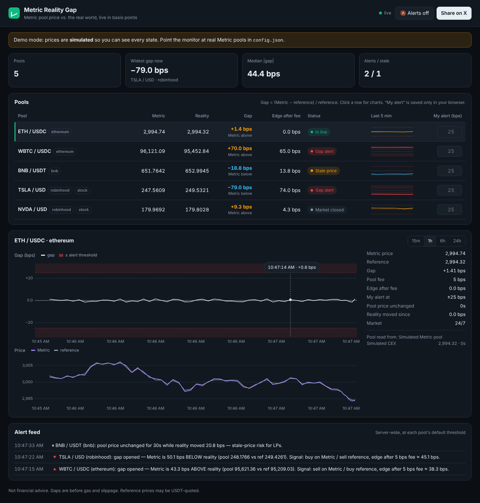

# Metric Reality Gap

**Metric says it is "the DEX that prices everything to reality." This tool checks that claim live.**

Every second it compares each [Metric](https://app.metric.xyz/) pool's price with real-world reference prices: Binance and Coinbase for crypto, and live stock quotes for tokenized stocks on Robinhood Chain. It shows the gap in basis points and sends alerts when the gap gets too wide.



## What you get

| | |
|---|---|
| **Live gap, in bps** | `(Metric price − reference) / reference × 10,000`, updated every second for every pool |
| **Arbitrage signal** | Direction (Metric above or below reality) and the edge left after the pool fee |
| **Stale-price detection** | Flags a pool whose price stops moving while the real market moves, which is the main risk for LPs |
| **History charts** | Gap and price, 15 min to 24 h, with your alert band drawn in |
| **Your own alerts** | Set a threshold per pool. Browser notification and sound. Saved only in your browser |
| **Public alert feed** | Server-side alerts to Telegram, Discord or Slack, with debounce and hysteresis so they don't spam |
| **Stock-market aware** | Gap alerts on stock pools pause while the US market is closed and the reference is frozen |
| **Share on X** | One click posts the current widest gap with a link to the dashboard |

## Try it in 30 seconds (simulated data)

```bash
npm install
```

```bash
npm run demo
```

Then open http://localhost:8787. Demo mode makes up prices, including gap spikes and frozen pools, so you can see every state and alert without any setup.

## Monitor real Metric pools

1. Copy the config files:

   ```bash
   cp config.example.json config.json
   ```

   ```bash
   cp .env.example .env
   ```

2. Add your RPC URLs and keys to `.env`. Use any Ethereum, BNB Chain or Robinhood Chain RPC. `FINNHUB_TOKEN` (free at finnhub.io) gives real-time stock prices; without it, the Yahoo fallback updates about every 15 seconds.

3. For each pool in `config.json`, fill in the pool **address** and **the function that returns its price**, taken from [Metric's docs](https://docs.metric.xyz/) or the verified contract on Etherscan or BscScan. Any read-only or quote function works:

   ```jsonc
   "pool": {
     "type": "evm-call",
     "address": "0x…",                                   // Metric pool / quoter
     "abi": "function getPrice() view returns (uint256)", // paste the real signature
     "method": "getPrice",
     "args": [],
     "decimals": 18,          // raw integer → price
     "invert": false          // true if it returns token0 per token1
   }
   ```

   For a quote-style function such as `quote(tokenIn, tokenOut, amountIn)`, pass a small `amountIn` in `args` and set `decimals` to the output token's decimals. If `amountIn` isn't exactly one token, set `divideBy` to the input amount in whole tokens. If Metric has a public HTTP API, use `"type": "http-json"` with `url` and `path` instead.

4. Check every feed once before going live:

   ```bash
   npm run check
   ```

   This prints each pool's Metric price, reference prices and gap, or the exact error.

5. Run it:

   ```bash
   npm start
   ```

### Reference sources

| type | for | needs |
|---|---|---|
| `binance` | crypto, WebSocket best bid/ask mid | nothing (for the US use `wsBase: wss://stream.binance.us:9443`) |
| `coinbase` | crypto, WebSocket ticker mid | nothing |
| `finnhub` | US stocks, real-time trades | free API key |
| `yahoo` | US stocks, polled | nothing |
| `evm-call` | on-chain oracles such as Chainlink, or any contract | RPC URL |
| `http-json` | any JSON price API | nothing |

When a pool has several reference sources, they are combined with `median` (the default), `mean` or `first`. The dashboard also shows how far the reference sources disagree with each other.

### Alert tuning (`alerts` in config)

| key | default | meaning |
|---|---|---|
| `defaultThresholdBps` | 30 | alert when \|gap\| ≥ this. Override per pool with `thresholdBps` |
| `confirmSec` | 3 | the gap must hold this long, so one-tick blips are ignored |
| `hysteresis` | 0.8 | the alert clears once \|gap\| < threshold × 0.8 |
| `renotifyFactor` | 2 | notify again if an open gap doubles |
| `staleAfterSec` / `staleRefMoveBps` | 60 / 15 | "stale" means the pool is unchanged this long while the reference moved this many bps |
| `alertWhenMarketClosed` | false | gap alerts on stock pools outside US market hours |

Telegram: create a bot with @BotFather, add it to your channel, and set `TELEGRAM_BOT_TOKEN` and `TELEGRAM_CHAT_ID`. Discord: create a channel webhook and set `DISCORD_WEBHOOK_URL`.

## Host it publicly

The server is **read-only**. Visitors can watch and set their own browser alerts, but they can't change anything on the server. Error messages are scrubbed of URLs so RPC keys never reach the browser.

**Docker**

```bash
docker compose up -d --build
```

This uses `config.json`, `.env` and `./data` for history.

**Render**: `render.yaml` is included. It starts in demo mode. Add your config as a secret file to go live (see the comments in the file).

Put it behind HTTPS (Caddy, Nginx, Cloudflare) and set `PUBLIC_URL` so alert messages link back to the dashboard.

## API

| endpoint | |
|---|---|
| `GET /api/snapshot` | current state of every pool plus recent alerts |
| `GET /api/stream` | Server-Sent Events: `tick` every second, `alert` as alerts fire |
| `GET /api/history?pool=ID&minutes=60` | `[time, metricPrice, refPrice, gapBps]` samples |
| `GET /api/alerts?limit=100` | alert log |
| `GET /healthz` | liveness |

## Development

```bash
npm test
```

The tests cover gap math, alert debounce and hysteresis, stale and feed-down detection, market hours, exchange message parsers, and on-chain reads against a local fake JSON-RPC node.

Layout: `src/feeds/` (price adapters), `src/engine.js` (gap and staleness per tick), `src/alerts.js` (alert state machine), `src/server.js` (API and SSE), `public/` (dashboard, no build step, no front-end dependencies).

## Caveats

- Gaps are before gas, slippage and CEX fees. A gap is a signal, not a guaranteed profit.
- USDT- or USDC-quoted references differ from USD by the stablecoin's own small deviation.
- Not financial advice. Not affiliated with Metric.

MIT licensed.
